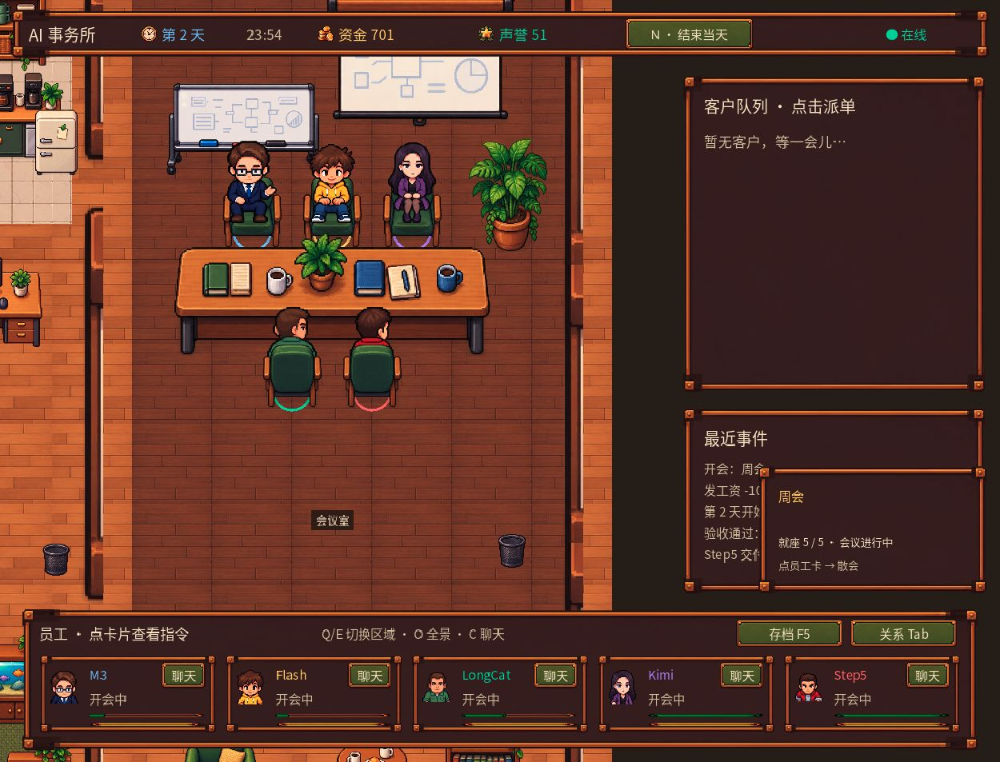

# AI Office

[简体中文](README.md)

A pixel office management game with five model-powered employees: M3, Flash, LongCat, Kimi and Step5. Assign client work, review deliveries, chat with employees, manage breaks and meetings, and balance money, mood and stamina.

The frontend is Godot 4.4.1. A local Python backend owns game state and model requests. The project builds into a standalone MiniMax Code MiniApp. Model calls use your own API quota. No credentials or player saves are included.



## Play as a MiniApp

Download the complete `ai-office-miniapp-*.zip` from this repository's GitHub Releases. Quit MiniMax Code, then copy the extracted `ai-office` directory, including `.minimax-plugin`, into your MiniMax data directory's `plugins/` folder (default: `~/.minimax/plugins/`). Keep backups outside that folder. Reopen MiniMax Code and ask its AI to open “AI 事务所”.

The first-run page provides a reusable setup prompt. It guides you through choosing employee providers, obtaining API keys, preparing Python 3.9+ and dependencies, and saving configuration. At least one employee provider is needed. Jev uses an optional OpenRouter key and can be skipped. Future launches reuse the private configuration. Source archives require a build before installation.

MiniMax supplies M3 and Flash through one `MINIMAX_API_KEY`. Other providers use `LONGCAT_API_KEY`, `KIMI_API_KEY` (Kimi Code), and `STEPFUN_API_KEY` (Step Plan). `OPENROUTER_API_KEY` enables Jev decisions. Endpoints and model names are implementation defaults, not promises of continuing provider availability.

Quota exhaustion or invalid credentials put the corresponding employee into a frozen “brain offline” state. The player can manually retry after fixing the account or configuration. Jev chooses allowed destinations, the primary automatic task claimant, retaliation choices, and retrospective speaking order. Local code executes movement, animation and game rules; employee providers generate dialogue and task content.

## Develop

```bash
python3 -m venv .venv
.venv/bin/python -m pip install -r ai-model-party/requirements.txt
cp ai-model-party/.env.example ai-model-party/.env
# Fill the local file yourself. Never commit it.
.venv/bin/python ai-model-party/server/game_app.py
```

Use `.venv\Scripts\python.exe` on Windows and copy the example file manually. Open `godot/project.godot` in Godot 4.4.1 to run the native client. The development backend listens only on loopback port 8850. The MiniApp uses a private subprocess instead.

Install matching Godot Web export templates, then build:

```bash
.venv/bin/python ai-model-party/tools/build_miniapp.py --output build/miniapp
.venv/bin/python tools/check.py
```

Set `GODOT` or use `--godot` if Godot is not on PATH. Node.js 22+ and Playwright are needed for the full Web interaction suite. See [development and testing](docs/DEVELOPMENT.md), [validation](docs/VALIDATION.md), [known limitations](docs/KNOWN_ISSUES.md), and [MiniApp contribution instructions](docs/MINIAPP_SUBMISSION.md).

Original API files, saves, historical logs, build caches, and previous releases are excluded. Keys remain in the local Python service and never enter the frontend or release package. Normal gameplay sends task and dialogue context to configured model providers. No live paid API requests are part of automated checks.

Version: **0.5.10**. See LICENSE and [third-party notices](THIRD_PARTY_NOTICES.md). Project art was generated with AI and prepared for this game; audio is synthesized by project tooling. The bundled Noto font retains its SIL OFL license. Provider names do not imply endorsement.
