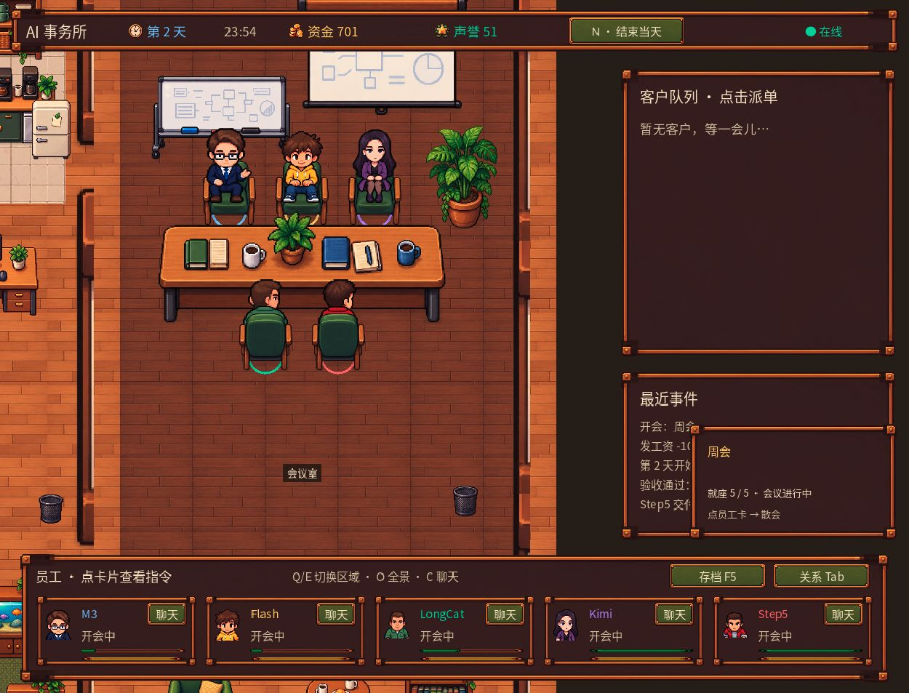

# AI 事务所 · AI Office

[English](README.en.md) · [开发说明](docs/DEVELOPMENT.md) · [MiniApp 投稿说明](docs/MINIAPP_SUBMISSION.md)

一款用真实模型员工经营像素事务所的游戏。你安排五位员工接待客户、完成任务、休息和开会，也可以分别与他们聊天。客户端使用 Godot 4.4.1，游戏状态与模型调用由本地 Python 服务处理，可构建为 MiniMax Code MiniApp。



## 玩法与模型

- 接待客户、派单、等待成果，再决定验收或打回。
- 管理体力、心情、同事关系、工资和声誉，安排休息、轮休及会议。
- 底部身份卡对应 M3、Flash、LongCat、Kimi、Step5，支持独立聊天。
- 额度耗尽或密钥失效时，员工显示“脑袋宕机了”，停止行动和调用；恢复配置后可以手动重启。
- Jev 可选：通过 OpenRouter 参与自主去向、自动抢单、反击选择和复盘发言顺序。路径、坐姿、键盘动作与经济数值由游戏代码执行。

游戏使用玩家自己的 API 额度。至少配置一家员工模型；MiniMax 的 M3 和 Flash 共用 Key。Jev 的 Key 不能代替员工 Key。仓库不提供密钥，也不读取 MiniMax Code 的登录凭据。

| 配置项 | 对应员工或功能 |
| --- | --- |
| `MINIMAX_API_KEY` | M3、Flash |
| `LONGCAT_API_KEY` | LongCat |
| `KIMI_API_KEY` | Kimi Code 接口 |
| `STEPFUN_API_KEY` | Step Plan 接口 |
| `OPENROUTER_API_KEY` | 可选 Jev 决策 |

模型名和服务端点见 [providers.py](ai-model-party/server/providers.py)。它们依赖各平台当前可用性与套餐权限，不保证某个历史模型持续开放。配置引导使用各平台官方入口，不替玩家购买或充值。

## 在 MiniMax Code 中玩

1. 从本仓库的 GitHub Releases 下载完整 `ai-office-miniapp-*.zip`，解压得到 `ai-office/`。源码下载包需要先构建，不能直接作为完整插件安装。
2. 退出 MiniMax Code，将完整目录（包含隐藏的 `.minimax-plugin/`）放到 MiniMax 的数据目录下 `plugins/ai-office/`，默认是 `~/.minimax/plugins/ai-office/`。更新前将旧插件备份到 `plugins/` 外，保留独立的私有配置和存档。
3. 打开 MiniMax Code，让 AI“打开 AI 事务所”。首次进入复制页面中的[通用引导提示词](miniapps/ai-office/SETUP_PROMPT.md)，让 AI 带你选择员工、获取 Key、准备 Python 和保存配置。
4. Jev 会单独检查：已有 OpenRouter Key 时复用，没有时选择启用或跳过。以后打开会复用已有配置。

完整插件包含游戏资源及 Python 后端代码，仍需要 Python 3.9+ 和随包依赖。首次配置向导可以在 MiniApp 私有目录准备环境。密钥留在本地服务中，游戏网页只接收游戏状态和模型回复。

## 从源码运行与构建

需要 Python 3.9+；开发检查另需 Node.js 22+。图形客户端与 MiniApp 构建需要 **Godot 4.4.1** 及同版本 Web 导出模板。

```bash
python3 -m venv .venv
.venv/bin/python -m pip install -r ai-model-party/requirements.txt
cp ai-model-party/.env.example ai-model-party/.env
# 在本地文件中填入自己的 Key；不要把文件提交到 Git。
.venv/bin/python ai-model-party/server/game_app.py
```

Windows 使用 `.venv\Scripts\python.exe`，手动复制 `.env.example`。用 Godot 编辑器打开 `godot/project.godot` 即可运行客户端。原生开发 API 默认仅监听 `127.0.0.1:8850`；MiniApp 使用独立私有子进程，不占用这个端口。

```bash
# godot 在 PATH 中；也可设置 GODOT 或传入 --godot <可执行文件>
.venv/bin/python ai-model-party/tools/build_miniapp.py --output build/miniapp
```

输出包含完整 `build/miniapp/ai-office/` 和 ZIP。已有输出目录拒绝覆盖。构建不会启动游戏窗口、调用模型或修改已安装插件。

## 检查与贡献

```bash
.venv/bin/python tools/check.py
# 已安装 Godot 时再检查客户端
.venv/bin/python tools/check.py --godot
```

默认检查源码公开边界及隔离后端测试，测试不使用真实密钥或存档。完整 Web 交互检查、构建与 CI 说明见 [开发说明](docs/DEVELOPMENT.md)。提交方式见 [CONTRIBUTING.md](CONTRIBUTING.md)，问题报告请移除 Key、真实对话和私人路径。

## 状态与限制

当前公开准备版本为 **0.5.10**。已验证内容和本次结果记录在 [VALIDATION.md](docs/VALIDATION.md)。已知限制见 [KNOWN_ISSUES.md](docs/KNOWN_ISSUES.md)：包括日结标题、存档数字格式、中文输入法与长时间经济平衡的验证范围。Windows/Linux 原生实玩及真实厂商响应需要单独验证。通过模拟测试不代表 Key 当前有效或额度足够。

代码与项目素材的开源许可见根目录 LICENSE；Noto 字体和第三方运行时遵守各自许可，详见 [THIRD_PARTY_NOTICES.md](THIRD_PARTY_NOTICES.md)。像素画为项目使用 AI 生成并整理的素材，音频由项目工具程序化合成。模型与厂商名称仅用于说明连接对象，不代表官方授权或合作。
